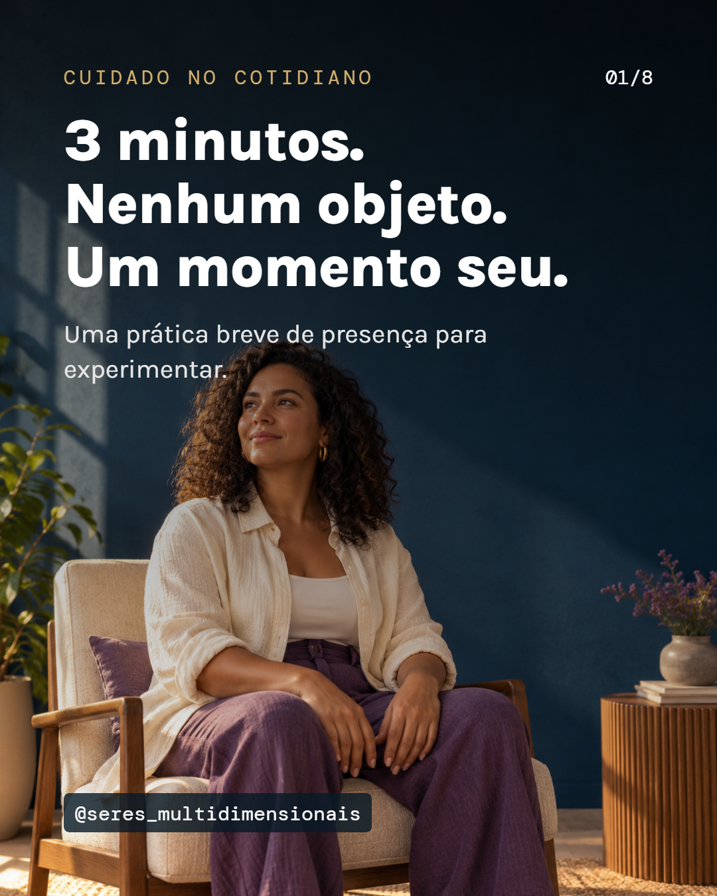
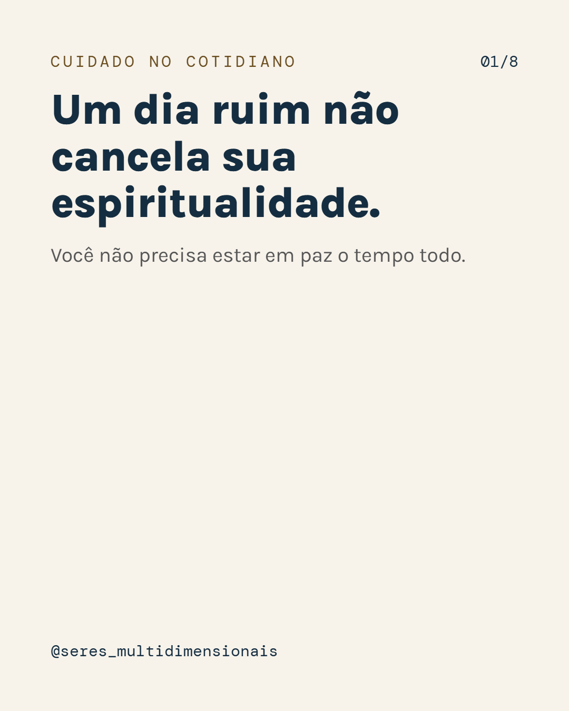
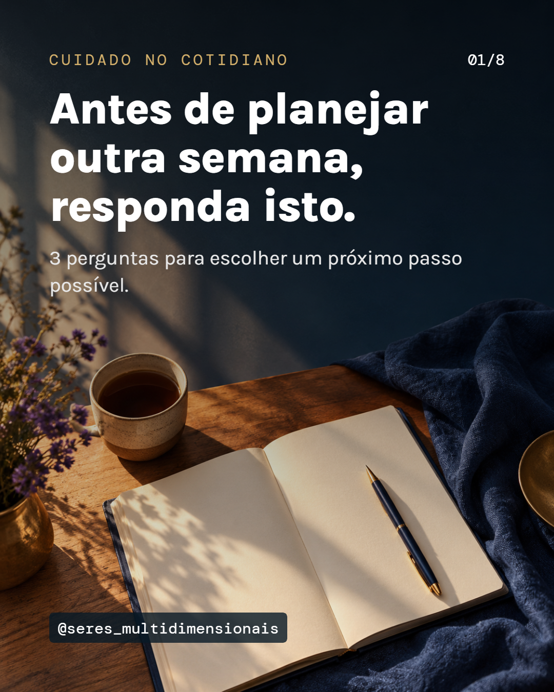

# Imagens de capa — semana 1

Fundos gerados por IA, sem texto. Pessoas fictícias. Na revisão de 26/10/2026, as capas dos dias 2 e 6 passaram a ser tipográficas em creme; os fundos gerados para esses dias foram preservados como acervo, mas não aparecem nos PNGs finais. Nenhum post publicado.

## Dia 1 — Você pode amar alguém e dizer: hoje não.

## Dia 2 — Nem todo dia pesado pede um ritual.

## Dia 3 — 3 minutos. Nenhum objeto. Um momento seu.

## Dia 4 — A saudade chegou. Você não precisa decidir hoje.

## Dia 5 — Seu ritual pode começar nesta pequena mesa.

## Dia 6 — Um dia ruim não cancela sua espiritualidade.

## Dia 7 — Antes de planejar outra semana, responda isto.

