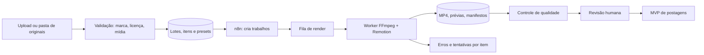

# REA funcional — Fábrica de Reels

**Data da observação:** 30/10/2026, horário de São Paulo. **Fonte:** [site público](https://fabricadereels.com.br/#inicio), incluindo seções Recursos, Como Funciona, Dúvidas, modal Termos de Uso e [Planos](https://fabricadereels.com.br/#pricing). Este é um estudo do comportamento apresentado ao visitante, sem conta ou teste de renderização. Complementa o [MVP de postagens](REA-POSTAGENS-MVP.md): produção de vídeo ocorre **antes** da aprovação e do agendamento.

## O que a ferramenta oferece ao visitante

| Função | Evidência pública | Estado | Utilidade para Ray |
| --- | --- | --- | --- |
| Envio de até 50 vídeos por lote, com miniaturas e fila | Página inicial, Como Funciona e FAQ | Declarado pelo fornecedor; não testado | Importação múltipla e estado individual por vídeo. |
| Corte/detecção de bordas, zoom, título e overlay aplicados ao lote | Recursos, Como Funciona e FAQ | Declarado; não testado | Preset reutilizável para acelerar edição dos originais. |
| Ajuste individual 1X; visualização em grade 2×2/3×3 | Recursos e FAQ | Declarado; não testado | Exceções por clipe sem alterar o preset do lote. |
| Até 10 perfis de overlay, conforme plano | Recursos e Planos | Declarado; limites variam por plano | Brand kits separados para Seres, Xamã e Aliança. |
| Legendas automáticas com IA | Como Funciona e Planos | Declarado; planos Plus/Pro/Business dizem incluir | Transcrição editável; revisão humana antes do render final. |
| Processamento remoto, progresso e ZIP final | Como Funciona, FAQ e Termos | Declarado; desempenho não testado | Render assíncrono, progresso e pacote para revisão. |
| “Anti-duplicidade” por 1,02×, espelhamento e limpeza de metadados | Recursos, FAQ e Planos | Alegação comercial, sem prova de efeito em distribuição | **Não** modelar como garantia de alcance ou modo de driblar detecção. Priorizar vídeo original e direito de uso. |
| 7 vídeos gratuitos; créditos pagos por quantidade | Planos vistos em 30/10 | Preços/condições declarados, sujeitos a alteração | Benchmark de modelo de cobrança, não requisito para o MVP. |
| Publicação direta, calendário ou API pública para integração | Nenhuma função correspondente encontrada no site público | Não verificado | Manter publicação no módulo próprio de postagens; não presumir API da Fábrica. |

**Divergências documentadas:** Planos anunciam Pix único e créditos sem expiração, enquanto o texto de Termos ainda fala em cotas/assinaturas mensais. O FAQ diz que arquivos de renderização são purgados em 24 horas; Termos dizem remoção após processamento. O FAQ também afirma IndexedDB local “criptografado por usuário”, mas isso não foi auditado. Verificar essas condições com o fornecedor antes de enviar material sensível ou comprar créditos. O site promete Reels “virais”; o resultado de alcance depende da peça, público e rede e não foi demonstrado pela página.

Os Termos restringem engenharia reversa do serviço. Este documento usa somente a interface pública e descreve uma implementação **original**; não examina o aplicativo autenticado, sua API privada ou seu código.

## Jornada própria proposta

1. Criar `lote_id` e escolher uma única `marca_id`. Vincular até 50 **vídeos próprios ou licenciados**; guardar fonte, duração, proporção, áudio e direito de uso. Limite de 50 é referência de UX, ajustável após medir infraestrutura.
2. Escolher preset de marca: logo correto, tipografia, cores, margem segura, título, rodapé e CTA. Gerar prévia curta de pelo menos um quadro de cada vídeo.
3. Aplicar regras globais: converter para 9:16, crop/letterbox **sem remover autoria ou marca d’água de terceiro**, normalizar áudio e adicionar texto. Ajustar exceções por clipe sem alterar os demais.
4. Se houver fala, transcrever e permitir correção de texto e tempos; bloquear a versão final enquanto houver legenda não revisada.
5. Renderizar em fila com progresso por item; validar duração, dimensão, codec, áudio, legibilidade e integridade do arquivo. Falha isolada não interrompe outros itens.
6. Entregar MP4 individuais, prévias, manifesto JSON/CSV e ZIP. Abrir a etapa editorial de `em_revisao` do MVP de postagens **somente** para os itens que Ray quiser usar.

Um lote pode conter variações editoriais, mas cada variação precisa de roteiro, mídia e valor próprios. Espelhar ou acelerar o mesmo vídeo para ocultar reaproveitamento não cria conteúdo original.

## Arquitetura proposta para n8n

O **n8n coordena** eventos e estados; render pesado roda em worker separado, com fila e limite de concorrência. **FFmpeg** trata inspeção, corte, escala, áudio e codificação. **Remotion**, já previsto no planejamento do Xamã, compõe títulos, legendas, animações e telas finais por marca. Armazenamento guarda originais e resultados com prazo definido por Ray; banco guarda metadados e histórico. Transcrição é adaptador opcional a escolher após teste de custo e qualidade em português. ZIP é criado só após todos os itens chegarem a `concluido` ou `falha`; manifesto identifica ambos. Nenhum desses serviços foi ativado aqui.

Estados do lote: `rascunho → validando → pronto → renderizando → concluido_parcial|concluido|falha`. Estados por item: `recebido → validado → previsualizado → renderizando → aguardando_qc → aprovado_tecnicamente|falha`. Aprovação técnica do arquivo **não** é aprovação editorial para publicar.

Dados mínimos: `lote_id`, `marca_id`, `preset_id`, `preset_versao`, `item_id`, `source_uri`, `source_sha256`, `direitos_uso`, `roteiro_id`, `titulo`, `legenda_texto`, `legenda_revisada`, `crop_por_item`, `output_uri`, `output_sha256`, `duracao_ms`, `largura`, `altura`, `codec`, `estado`, `erro`, `tentativas`, `criado_em`, `atualizado_em`. O preset e o vídeo original ficam versionados; repetir o mesmo trabalho usa chave `(item_id, preset_versao, roteiro_id)` e não duplica arquivo silenciosamente.

## Prioridade e critérios de aceite

| Prioridade | Entrega | Critério observável |
| --- | --- | --- |
| P0 | Lote e validação de originais | 10 arquivos válidos geram 10 itens; arquivo corrompido é rejeitado com erro próprio; mistura de marcas é bloqueada. |
| P0 | Preset por marca e prévia | Seres, Xamã e Aliança mostram logo, fonte e cores corretos; área de texto não corta rosto nem interface prevista da rede. |
| P0 | Render em fila e ZIP | Cada item tem status e saída verificável; falha de um item preserva os demais; ZIP traz manifesto e somente saídas íntegras. |
| P1 | Ajuste individual | Crop/título de um item podem mudar sem modificar o preset ou os outros itens. |
| P1 | Legendas revisáveis | Texto e tempo podem ser corrigidos; legenda automática não revisada não entra no render final. |
| P1 | Ligação ao calendário | Um MP4 final cria rascunho com `marca_id`, versão e canal; não altera estado para `aprovado` nem agenda sozinho. |
| P2 | Geração a partir de roteiro | Roteiro original + mídia licenciada + voz autorizada geram prévia; Ray escolhe e revisa antes da renderização definitiva. |

**Teste piloto sugerido:** três vídeos originais, um de cada marca, mais um arquivo inválido; renderizar primeiro com marca d’água interna de prévia. Medir tempo por minuto de vídeo, tamanho final, falhas, erros de legenda e ajustes manuais. Depois testar lote de 10. Não assumir a promessa externa de 25–30 segundos por vídeo como meta técnica.

**Faltam para aprofundar a comparação:** acesso consentido a uma conta de teste da Fábrica (se Ray já a possui), vídeo demonstrativo de um lote real, política atual de armazenamento e esclarecimento sobre planos. Esses itens não impedem começar o protótipo próprio com originais de Ray.
