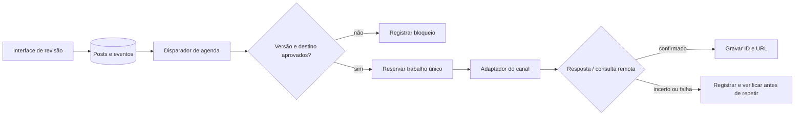

# REA: aplicativo próprio de postagens — primeira especificação

**Estado:** rascunho técnico, 26/10/2026. **Objetivo:** organizar a produção de Seres Multidimensionais, Xamã Pena Azul do Amor e Aliança Terapêutica 520, com automação futura via n8n. Nenhuma integração ou publicação foi executada neste trabalho.

## Evidência e limites

| Função | Evidência | Estado | Consequência para o aplicativo |
| --- | --- | --- | --- |
| Planejamento editorial separado por marca e canal | `operacao/ORQUESTRACAO.md` e calendários em `marcas/*/planejamento/` | Observado no repositório | Guardar `marca_id`, canal e conta de destino em cada peça. |
| Revisão, aprovação, agendamento e publicação como etapas diferentes | `operacao/ORQUESTRACAO.md` | Observado no repositório | Transição de estado exige evento e responsável identificados. |
| Análise de concorrentes na Metricool | [Central de ajuda da Metricool](https://help.metricool.com/competitor-analysis-ouhue) | Documentado publicamente | Considerar como referência de produto; acesso aos dados da conta não foi verificado nesta sessão. |
| Coleta atual de concorrentes da conta Xamã | `marcas/xama-pena-azul-do-amor/planejamento/2026-11/FONTES.json`, consulta de 25/10/2026 | Observado no relatório local: nenhuma linha retornada | Não calcular ranking, mediana ou viralização com amostra vazia. |
| Publicar diretamente pelo n8n em Instagram, Facebook, TikTok e YouTube | Ainda sem prova das permissões e contas para cada canal | Não verificado | Criar adaptadores por canal somente após validar API oficial e credenciais de teste. |

As issues abertas e fechadas de `Rayarend/ray` foram consultadas pela API do GitHub em 26/10/2026: **zero**. Os commits recentes têm referências textuais a tarefas, mas não constituem issues acessíveis neste repositório.

## Jornada do MVP

1. Criar peça em `rascunho`, escolhendo marca, canal, conta de destino, formato e mídia.
2. Revisar texto, mídia, direitos de uso e prévia específica do canal; registrar versão.
3. Enviar para `em_revisao`. Ray aprova versão **e** destino explícitos.
4. Programar data/hora em `America/Sao_Paulo`, persistindo instante em UTC. Mostrar ambos antes de confirmar.
5. No horário, n8n recebe um único trabalho para a versão aprovada, valida novamente conta e mídia, chama o adaptador autorizado e grava o identificador remoto.
6. Em falha, registrar erro, tentativas e próxima ação. Não repetir envio quando houver possibilidade de publicação já aceita sem antes consultar o estado remoto.
7. Após publicação confirmada, guardar URL/ID e horário real. Métricas entram em coleta separada, com data, fonte e cobertura.

Estados: `rascunho → em_revisao → aprovado → agendado → publicando → publicado`. Caminhos controlados: `rejeitado → rascunho`, `agendado → cancelado`, `publicando → falha`, `falha → em_revisao` ou nova tentativa após verificação. Editar texto, mídia ou destino aprovado cria versão nova e retorna à revisão.

## Dados mínimos

`post_id`, `marca_id`, `versao`, `canal`, `conta_destino_id`, `formato`, `midias[]` (URI, tipo e direitos), `legenda`, `alt_text`, `estado`, `aprovado_por`, `aprovado_em`, `programado_para_utc`, `fuso_exibicao`, `idempotency_key`, `remote_post_id`, `remote_url`, `tentativas`, `ultima_falha`, `criado_em`, `atualizado_em`. Tabelas separadas: `contas_destino`, `aprovacoes`, `eventos_post`, `metricas_coletadas`. Uma peça adaptada para dois canais gera dois trabalhos de publicação, cada um com aprovação/destino próprios.

## Fluxos n8n propostos

O n8n orquestra; o banco guarda a fonte de verdade e uma chave única por `(post_id, versao, canal, conta_destino_id)`. Credenciais ficam em cofre próprio da execução, fora do Git. Cada adaptador precisa documentar permissões, formatos aceitos, limites, caminho de consulta remota e política de repetição. Não presumir que todas as APIs aceitem Stories, carrosséis ou agendamento da mesma forma.

## Backlog executável

| Prioridade | Entrega | Critério de aceite |
| --- | --- | --- |
| P0 | Cadastro de marcas e destinos | Teste impede agendar sem `marca_id` e `conta_destino_id`; nomes parecidos não fundem contas. |
| P0 | Rascunho, versão e revisão | Alterar mídia, texto ou destino após aprovação invalida a aprovação anterior; histórico preservado. |
| P0 | Agenda e fuso | Horário exibido em São Paulo corresponde ao UTC armazenado, inclusive em mudança de fuso; cancelamento impede disparo. |
| P0 | Fila idempotente e auditoria | Dois disparos do mesmo trabalho produzem no máximo uma tentativa ativa; resultado incerto bloqueia repetição automática até reconciliação. |
| P1 | Adaptador de **um** canal piloto | Publica em conta de teste autorizada, registra ID/URL ou erro; casos de mídia inválida e permissão ausente têm mensagem clara. Canal piloto ainda depende de confirmação. |
| P1 | Prévia e checagem de mídia | Usuário vê proporção, ordem dos slides, legenda e destino antes de pedir aprovação. |
| P2 | Métricas próprias | Cada dado inclui fonte, instante de coleta, período e definição; ausência de dado aparece como `indisponível`, não zero. |
| P2 | Pesquisa de concorrentes | Importa apenas métricas acessíveis/autorizadas com URL e data; calcula mediana por perfil e formato somente com amostra suficiente. |

**Decisão pendente:** escolher canal e conta de teste do primeiro adaptador. A análise de concorrentes pode começar com as contas candidatas já listadas nos planejamentos, mas precisa de dados atuais e comparáveis antes de influenciar ranking editorial. Nenhuma peça deste documento está aprovada para postagem.
